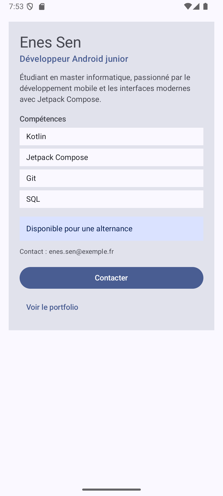

# Profil développeur Compose

## Description

Cette application Android affiche la fiche « Profil développeur » d'un étudiant en informatique, réalisée avec Jetpack Compose.
L'écran présente le nom, le rôle, une courte description, une liste de compétences, la disponibilité et un contact.
Deux actions sont proposées : un bouton « Contacter » et une zone cliquable « Voir le portfolio ».
L'interface est découpée en petits composables réutilisables, et plusieurs previews affichent des profils différents.

## Notions utilisées

- fonctions composables (`@Composable`) ;
- paramètres ;
- `Modifier` et chaînage de modifiers (`fillMaxWidth`, `padding`, `clickable`, `semantics`) ;
- padding externe et padding interne ;
- callbacks (`() -> Unit`) ;
- `Text`, `Button`, `Surface`, `Column` ;
- `MainActivity`, `setContent`, thème généré, `Scaffold` et `innerPadding` ;
- previews (`@Preview`) ;
- accessibilité de base (`semantics`, `Role.Button`, `contentDescription`).

## Explication

**1. Quels composables avez-vous créés ?**

- `ProfileScreen` : l'écran principal ;
- `ProfileCard` : la fiche complète du profil ;
- `ProfileHeader` : le nom et le rôle ;
- `SkillList` : la liste des compétences ;
- `SkillItem` : une compétence ;
- `AvailabilityInfo` : la disponibilité (disponible / non disponible) ;
- `ContactInfo` : l'information de contact ;
- `ContactButton` : le bouton « Contacter » ;
- `PortfolioLink` : la zone cliquable personnalisée « Voir le portfolio » ;
- trois previews : `ProfileScreenPreview`, `ProfileCardAndroidJuniorPreview` et `ProfileCardFullStackUnavailablePreview`.

**2. Quel composable représente l'écran principal ?**

C'est `ProfileScreen`. Il est appelé dans `MainActivity` à l'intérieur du `Scaffold`, avec `Modifier.padding(innerPadding)`. C'est lui qui fournit les données du profil à `ProfileCard`.

**3. Où utilisez-vous un padding externe ?**

Le padding externe est décidé par le parent et passé au composant enfant par son paramètre `modifier` :

- dans `ProfileScreen`, `modifier.fillMaxWidth().padding(16.dp)` place la fiche à distance des bords de l'écran ;
- dans `ProfileCard`, les enfants reçoivent par exemple `Modifier.padding(top = 16.dp)` (`SkillList`, `AvailabilityInfo`, `ContactButton`…) pour les espacer entre eux ;
- dans `SkillList`, chaque `SkillItem` reçoit `Modifier.fillMaxWidth().padding(top = 6.dp)`.

**4. Où utilisez-vous un padding interne ?**

Le padding interne est appliqué à l'intérieur d'un composant, pour espacer son propre contenu de ses bords :

- dans `ProfileCard`, la `Column` à l'intérieur de la `Surface` a `Modifier.padding(20.dp)` ;
- dans `SkillItem`, le `Text` a `Modifier.padding(horizontal = 12.dp, vertical = 6.dp)` ;
- dans `AvailabilityInfo`, le `Text` a `Modifier.padding(12.dp)` ;
- dans `PortfolioLink`, le dernier `.padding(12.dp)` de la chaîne agrandit la zone cliquable autour du texte.

La différence : le padding externe sert à **placer** le composant dans l'écran, alors que le padding interne sert à **aérer son contenu**. Le composant ne choisit jamais lui-même sa marge externe : il reçoit un `modifier` du parent.

**5. Quel composant reçoit un callback ?**

- `ContactButton` reçoit `onClick: () -> Unit` et le transmet au `Button` ;
- `PortfolioLink` reçoit `onClick: () -> Unit` et l'utilise dans `clickable` ;
- `ProfileCard` reçoit `onContactClick` et `onPortfolioClick` et les fait remonter jusqu'à `ProfileScreen`.

Les composants signalent seulement le clic. C'est le parent (`ProfileScreen`) qui décide quoi faire ; pour l'instant, il passe des lambdas vides `{}`.

**6. Quelle information d'accessibilité avez-vous ajoutée ?**

`PortfolioLink` est un `Text` rendu cliquable avec `clickable`. Sans information en plus, un lecteur d'écran ne saurait pas que c'est une action. On lui ajoute donc :

```kotlin
.semantics {
    role = Role.Button
    contentDescription = "Ouvrir le portfolio du développeur"
}
```

TalkBack l'annonce alors comme un bouton, avec une description claire de l'action.
`ContactButton` utilise directement `Button`, qui est déjà explicite : Compose lui donne automatiquement le rôle de bouton, et son texte « Contacter » sert de libellé.

Exemple de chaîne de modifiers qui a du sens (dans `PortfolioLink`) :

```kotlin
modifier
    .fillMaxWidth()
    .clickable(onClick = onClick)
    .semantics { ... }
    .padding(12.dp)
```

La largeur et le clic sont appliqués avant le padding : toute la ligne est cliquable, et le texte est espacé à l'intérieur de cette zone.

**7. Pourquoi vos composants peuvent-ils être considérés comme réutilisables ?**

- Ils ne contiennent pas de données en dur : ils reçoivent leur contenu par des paramètres (nom, rôle, compétences, disponibilité, texte du bouton…).
- Ils acceptent tous un paramètre `modifier: Modifier = Modifier`, ce qui laisse le parent décider de leur placement.
- Les actions sont exposées sous forme de callbacks : le composant ne décide pas de la logique de l'application.
- La preuve : la même `ProfileCard` affiche trois profils différents (Enes Sen sur l'écran principal, Léa Martin en Android junior disponible, Karim Benali en full-stack non disponible) sans changer son code.

## Capture



## Lien du dépôt

https://github.com/<votre-utilisateur>/ProfilDeveloppeur
